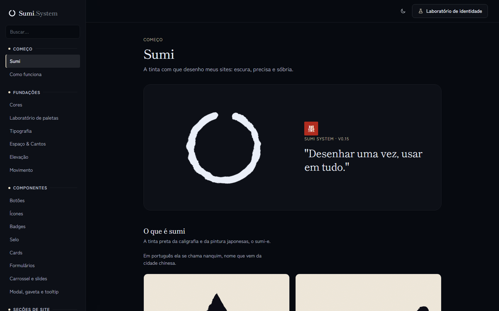

# 018 — De Nanquim a Sumi

**Data:** 2026-11-01 · **Versão:** 0.15.0 · **Prints:** [`prints/2026-11-01_sumi/`](prints/2026-11-01_sumi/)

## Contexto
Numa revisão, duas anotações mudaram a identidade: "nanquim" vem de uma cidade chinesa, o termo japonês para a tinta é sumi, e a logo circular combinava com o ensō.

## O que foi feito
- Sistema, tema e documentação renomeados para Sumi (`data-theme="sumi"`).
- Fontes japonesas como padrão: Shippori Mincho e Zen Kaku Gothic New (`data-font="sumi"`).
- Logo e favicon em ensō.
- Selo `ds-seal` com o kanji 墨 e o vermelhão `--ds-color-seal`.
- Princípios da apresentação trocados por Kanso, Ma, Nōtan e Shibui.

## Decisões (e por quê)
| Decisão | Alternativas consideradas | Motivo |
|---|---|---|
| Vermelhão só no selo | Usar como cor de destaque | O sistema segue sóbrio, e o vermelho funciona como a única nota de cor |
| Selo com cor fixa | Seguir a paleta da marca | Na pintura, o carimbo tem tinta própria |
| Manter os registros antigos | Reescrever o diário | A história é de quando o projeto se chamava Nanquim; a mudança entra como versão nova |
| Manter o repositório e o cofre com o nome antigo | Renomear agora | Renomear muda a URL pública e os links das notas; fica como decisão à parte |

## Problemas encontrados
- **Problema:** a preferência salva no Laboratório guardava `nanquim`. → **Solução:** nova chave de armazenamento, `sumi-lab-v1`.

## Antes / depois

## Aprendizados
- Revisar a origem do nome pode render uma identidade mais coerente do que a primeira.

## Próximos passos
- [ ] Decidir a renomeação do repositório no GitHub.
- [ ] Pacote para npm e CDN.

## Ideia de post
> Meu design system se chamava Nanquim, e a palavra era chinesa. Virou Sumi: novo nome, logo ensō e um único carimbo vermelho. Print: abertura.
