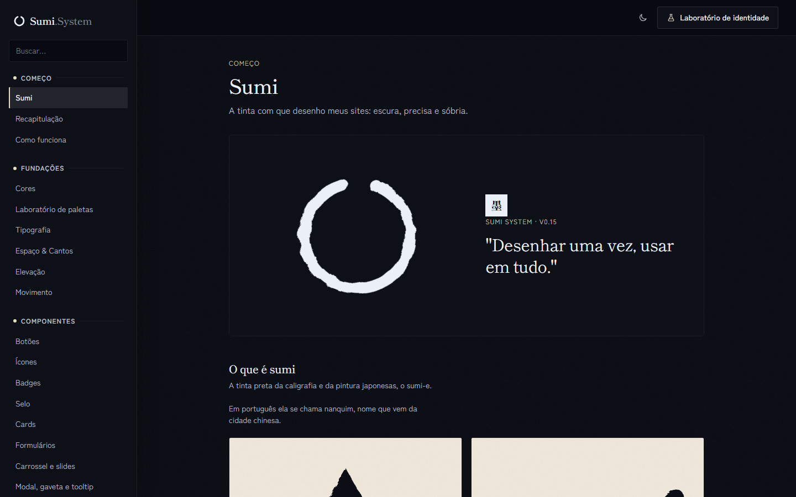

# 019 — Mundo de papel

**Data:** 2026-11-01 · **Versão:** 0.16.0 · **Prints:** [`prints/2026-11-01_mundo-de-papel/`](prints/2026-11-01_mundo-de-papel/)

## Contexto
O selo vermelho destoava do sistema, e a identidade pedia uma matéria única: papel.

## O que foi feito
- Selo em preto e branco, que inverte com o modo.
- Grão de papel, sombras de folha e cantos retos por padrão.
- Página Recapitulação, com o sistema inteiro em uma folha.
- Peças `ds-sheet`, `ds-paper-hero`, `ds-diorama`, `ds-ledger` e `ds-stack`.
- Quatro modelos novos: Editora, Festival, Casa de chá e Revista.

## Decisões (e por quê)
| Decisão | Alternativas consideradas | Motivo |
|---|---|---|
| Ilustrações em camadas de SVG | Fotos de banco | Seguem a marca e os dois modos |
| Só conteúdo fictício assumido | Depoimentos e números de exemplo | Exemplo não deve parecer prova real |

## Problemas encontrados
- **Problema:** no Festival, o título caía abaixo da dobra. → **Solução:** abertura em duas colunas.
- **Problema:** o grão ficava forte no escuro. → **Solução:** metade da opacidade.

## Antes / depois

## Aprendizados
- Trocar a sombra e o fundo muda a matéria do sistema inteiro de uma vez; tokens pagam isso.

## Próximos passos
- [ ] Pacote para npm e CDN.

## Ideia de post
> Tirei a única cor do meu design system e ele virou papel. Sombra de folha, grão e quatro sites recortados. Print: Festival.
