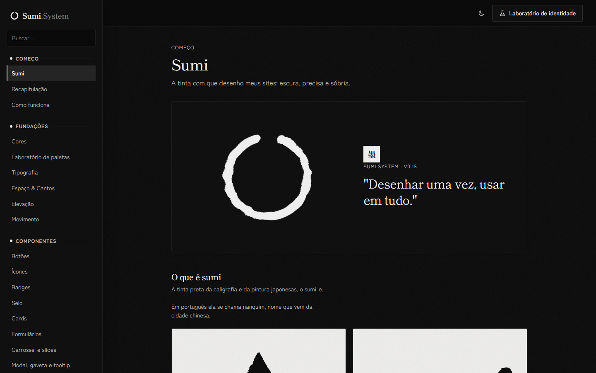

# 020 — Preto e branco com referências do Pinterest

**Data:** 2026-11-01 · **Versão:** 0.17.0 · **Prints:** [`prints/2026-11-01_preto-e-branco/`](prints/2026-11-01_preto-e-branco/)

## Contexto
A busca "design preto e branco minimalista japonês" no Pinterest mostrou pintura sumi-e: muito vazio, tinta que se dissolve, kanji vertical, respingos e selo pequeno.

## O que foi feito
- Tema Sumi sem croma: preto e branco puros.
- Cenários dos modelos de papel viraram pintura, com borda de pincel, névoa e respingos.
- Kanji vertical e selo pequeno nas aberturas; tiras verticais no Festival.

## Decisões (e por quê)
| Decisão | Alternativas consideradas | Motivo |
|---|---|---|
| Traduzir padrões, sem copiar pins | Usar as imagens | Os pins têm autores, e o desenho precisa seguir o tema |

## Problemas encontrados
- **Problema:** o sol do Festival era cortado pela tira. → **Solução:** sol dentro da primeira tira.

## Antes / depois

## Aprendizados
- O vazio faz mais pela estética japonesa do que qualquer ornamento.

## Próximos passos
- [ ] Pacote para npm e CDN.

## Ideia de post
> Tirei toda a cor do sistema depois de uma tarde no Pinterest. Print: Festival.
