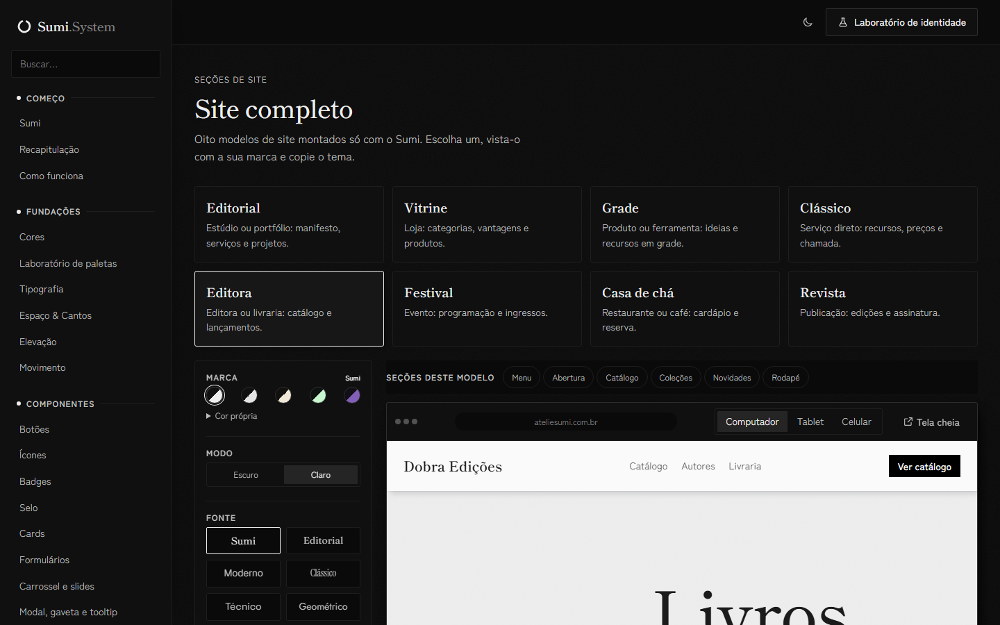

# 021 — Aberturas de web design japonês

**Data:** 2026-11-01 · **Versão:** 0.18.0 · **Prints:** [`prints/2026-11-01_web-japones/`](prints/2026-11-01_web-japones/)

## Contexto
A busca anterior trouxe pinturas. A nova, "web design preto e branco minimalista japonês", trouxe layouts de site.

## O que foi feito
- Editora: kanji gigante como estrutura e texto vertical na lateral (`ds-hero-rail`).
- Festival: palavra-pôster sobre linha fina (`ds-hero-poster`).
- Casa de chá: corte diagonal entre branco e preto (`ds-hero-diagonal`).
- Revista: painéis preto e branco lado a lado (`ds-hero-panels`).

## Decisões (e por quê)
| Decisão | Alternativas consideradas | Motivo |
|---|---|---|
| Uma abertura diferente por modelo | Um layout só | Cada referência resolve um tipo de site |

## Problemas encontrados
- **Problema:** a Revista não abria em colunas. → **Solução:** a consulta de contêiner não vale para o próprio elemento; entrou uma grade interna.

## Antes / depois

## Aprendizados
- A busca certa muda a referência: "design" traz imagem, "web design" traz estrutura.

## Próximos passos
- [ ] Pacote para npm e CDN.

## Ideia de post
> Uma palavra na busca mudou tudo: de pinturas para layouts. Print: Editora.
