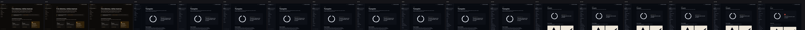
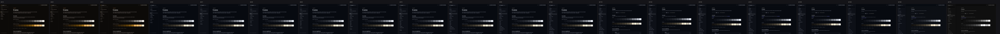
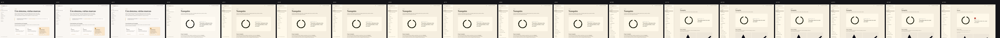
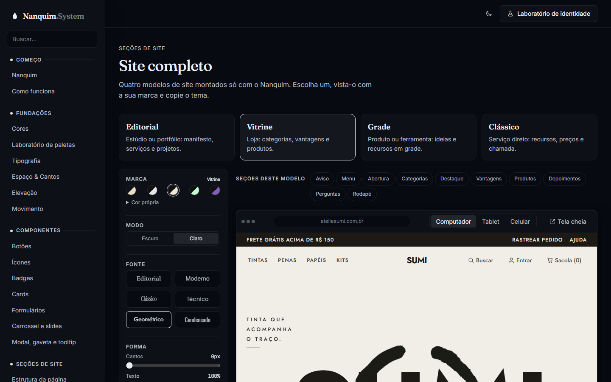
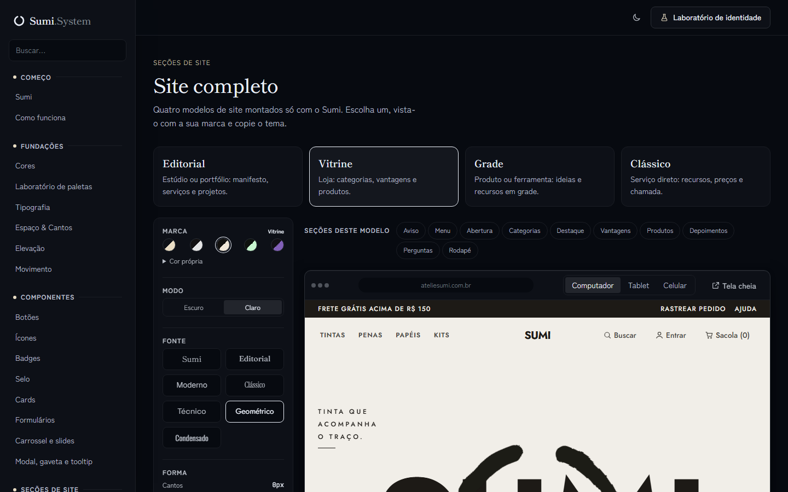
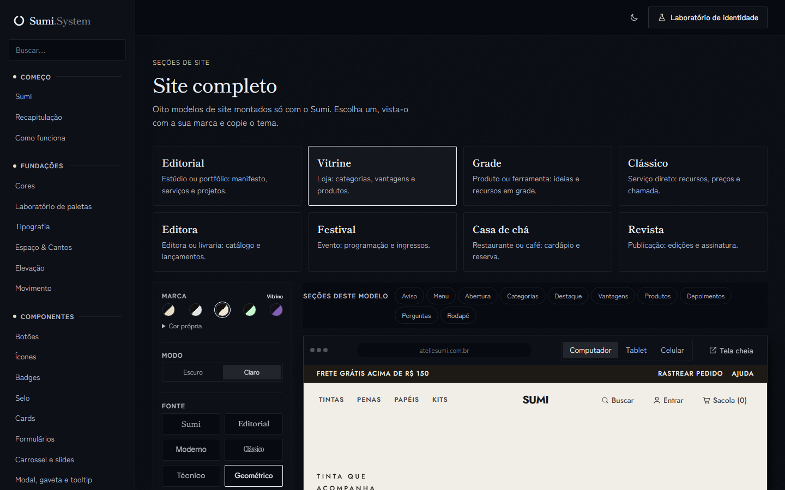
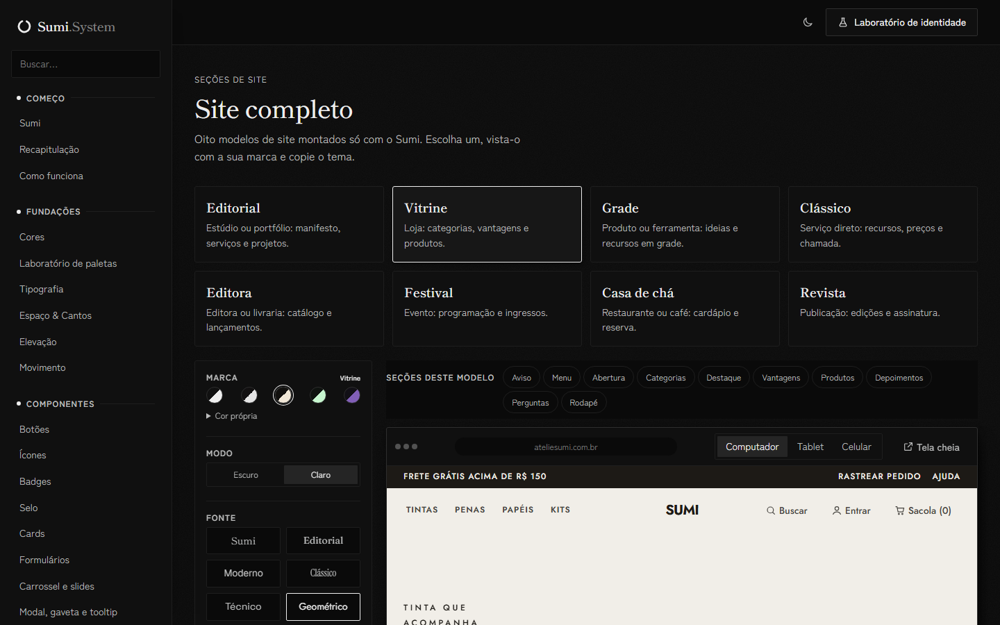

# Evolução do Sumi System

Como o projeto mudou, versão a versão, em fotos. Cada versão tem uma **tag no git** (`git checkout v0.2.0` volta
exatamente àquele estado), e todas as capturas abaixo foram feitas do mesmo jeito: mesmas telas, mesmo tamanho,
geradas a partir do próprio histórico com `npm run evolucao`.

**Documentação ao vivo:** https://andreluaan.github.io/Nanquim-System/ · **Versão em PDF:** [Sumi-System-Evolucao.pdf](Sumi-System-Evolucao.pdf)

## Linha do tempo

| Versão | Data | Marco | Páginas | Componentes | Paletas |
|---|---|---|---|---|---|
| v0.0 | 2026-10-20 | Rascunho, ainda sem nome e sem git | 7 | 0 | 4 + marca de exemplo |
| [v0.1.0](#v010--fundações) | 2026-10-20 | Fundações | 7 | 0 | 4 + marca de exemplo |
| [v0.2.0](#v020--botões) | 2026-10-22 | Botões | 8 | 1 | 4 + marca de exemplo |
| [v0.2.1](#v021--paleta-neutra) | 2026-10-22 | Paleta Neutra | 8 | 1 | 5 + marca de exemplo |
| [v0.3.0](#v030--tema-nanquim) | 2026-10-22 | Identidade Nanquim | 9 | 1 | Nanquim + 5 + marca de exemplo |
| [v0.3.1](#v031--profundidade-e-modo-claro) | 2026-10-22 | Profundidade e modo claro | 9 | 1 | Nanquim + 5 + marca de exemplo |
| [v0.4.0](#v040--ícones) | 2026-10-22 | Ícones e primeiro Web Component | 10 | 2 | Nanquim + 5 + marca de exemplo |
| [v0.5.0](#v050--badges-e-cards) | 2026-10-22 | Badges e cards | 12 | 4 | Nanquim + 5 + marca de exemplo |
| [v0.6.0](#v060--formulários) | 2026-10-23 | Formulários | 13 | 5 | Nanquim + 5 + marca de exemplo |
| [v0.7.0](#v070--carrossel-e-slides) | 2026-10-23 | Carrossel e slides | 14 | 6 | Nanquim + 5 + marca de exemplo |
| [v0.8.0](#v080--modal-gaveta-e-tooltip) | 2026-10-23 | Modal, gaveta e tooltip | 15 | 8 | Nanquim + 5 + marca de exemplo |
| [v0.9.0](#v090--seções-de-site) | 2026-10-23 | Seções de site | 16 | 16 | Nanquim + 5 + marca de exemplo |
| [v0.10.0](#v0100--seções-separadas-e-visualizador) | 2026-10-23 | Seções separadas e visualizador | 25 | 17 | Nanquim + 5 + marca de exemplo + cor livre |
| [v0.11.0](#v0110--textos-enxutos-e-cópia-de-valores) | 2026-10-23 | Textos enxutos e cópia de valores | 25 | 17 | Nanquim + 5 + marca de exemplo + cor livre |
| [v0.12.0](#v0120--modelo-editorial-e-tela-cheia) | 2026-10-23 | Modelo editorial e tela cheia | 29 | 21 | Nanquim + 5 + marca de exemplo + cor livre |
| [v0.13.0](#v0130--aguada-laboratório-de-paletas-vitrine-e-grade) | 2026-10-23 | Aguada, laboratório de paletas, Vitrine e Grade | 30 | 22 | Nanquim + 3 da aguada + marca de exemplo + cor livre |
| [v0.13.1](#v0131--vitrine-padrão-e-painel-em-grade) | 2026-10-23 | Vitrine padrão e painel em grade | 30 | 22 | Nanquim + 3 da aguada + marca de exemplo + cor livre |
| [v0.14.0](#v0140--site-completo-organizado-por-modelo) | 2026-10-28 | Site completo organizado por modelo | 30 | 22 | Nanquim + 3 da aguada + marca de exemplo + cor livre |
| [v0.15.0](#v0150--de-nanquim-a-sumi) | 2026-11-01 | De Nanquim a Sumi | 31 | 23 | Sumi + 3 da aguada + marca de exemplo + cor livre |
| [v0.16.0](#v0160--mundo-de-papel) | 2026-11-01 | Mundo de papel | 32 | 24 | Sumi + 3 da aguada + marca de exemplo + cor livre |
| [v0.17.0](#v0170--preto-e-branco) | 2026-11-01 | Preto e branco | 32 | 24 | Sumi + 3 da aguada + marca de exemplo + cor livre |
| [v0.18.0](#v0180--aberturas-de-web-design-japonês) | 2026-11-01 | Aberturas de web design japonês | 32 | 24 | Sumi + 3 da aguada + marca de exemplo + cor livre |

### A mesma tela em cada versão

**Abertura:**

**Cores:**

**Modo claro:**

---

## v0.0 — Rascunho

*Antes do primeiro commit.* O projeto ainda se chamava "design.system" e não tinha identidade: o objetivo era criar a
estrutura e as ferramentas para escolher uma junto. Detalhes em [001-fundacoes.md](001-fundacoes.md).

| Abertura | Laboratório de identidade |
|---|---|
|  |  |

---

## v0.1.0 — Fundações

*2026-10-20 · tag `v0.1.0` · diário: [001](001-fundacoes.md)*

- Tokens em 3 camadas (primitivos → semânticos → temas), com cores geradas em OKLCH a partir de 4 números
- 4 propostas de paleta, 4 pares tipográficos, 3 estilos de cantos, modos escuro e claro
- Documentação interativa: Cores, Tipografia, Espaço & Cantos, Elevação, Movimento e Roadmap
- Laboratório de identidade, selo de contraste ao vivo e capturas automáticas (`npm run prints`)
- Nome definido: **Nanquim System**. Repositório criado e documentação publicada no GitHub Pages.

| Abertura | Cores |
|---|---|
|  |  |
| **Modo claro** | **Laboratório** |
|  |  |

---

## v0.2.0 — Botões

*2026-10-22 · tag `v0.2.0` · diário: [002](002-botoes.md)*

- Primeiro componente: `ds-btn`, com 7 estilos, 3 tamanhos, ícones, estados (carregando, desativado) e grupo
- Playground "Monte o seu", com botão e código mudando juntos
- Contraste verificado automaticamente em 70 combinações (5 paletas × 2 modos × 7 estilos)
- Código mais legível: nomes de variável autoexplicativos, poucos comentários, formatação padronizada

| Botões | Botões no celular |
|---|---|
|  |  |

---

## v0.2.1 — Paleta Neutra

*2026-10-22 · tag `v0.2.1` · diário: [003](003-paleta-neutra.md)*

- Quinta paleta: só preto, branco e cinzas, com o destaque invertendo conforme o modo
- Logo com N e S maiúsculos: **Nanquim.System**

| Abertura | Botões |
|---|---|
|  |  |

---

## v0.3.0 — Tema Nanquim

*2026-10-22 · tag `v0.3.0` · diário: [004](004-tema-nanquim.md)*

- **Identidade da casa:** o tema Nanquim vira o padrão. Escuro é a tinta (preto-azulado com destaque marfim), claro é o papel.
- Página de apresentação do conceito: ensō animado, galeria com ilustrações em SVG, os 4 princípios e a aguada interativa
- Logo em forma de gota de tinta

| Abertura (tinta) | Abertura (papel) |
|---|---|
|  |  |

Página de apresentação completa: [`07-pagina-completa.png`](evolucao/v0.3.0/07-pagina-completa.png)

---

## v0.3.1 — Profundidade e modo claro

*2026-10-22 · tag `v0.3.1` · diário: [005](005-profundidade-modo-claro.md)*

- O modo claro deixa de ser "branco demais": os neutros ganham cor (`--ds-neutral-tint`), com dose ajustada por paleta
- A sidebar vira uma camada própria, com superfície, sombra e itens maiores
- Sombras mais presentes nos dois modos

| v0.3.0 · modo claro | v0.3.1 · modo claro |
|---|---|
|  |  |

Todas as paletas no modo claro, depois do ajuste:

---

## v0.4.0 — Ícones

*2026-10-22 · tag `v0.4.0` · diário: [006](006-icones.md)*

- 53 ícones em 7 categorias, com o mesmo traço: grade 24×24, linha de 1.75 e pontas arredondadas, como uma pena de nanquim
- `<ds-icon>`, o primeiro Web Component: 4 tamanhos, 3 espessuras e acessível por padrão
- Página com busca em português, cópia do código ou do SVG puro e a anatomia do traço

| Biblioteca de ícones | Ícones nos botões |
|---|---|
|  |  |

---

## v0.5.0 — Badges e cards

*2026-10-22 · tag `v0.5.0` · diário: [007](007-badges-cards.md)*

- Badge com 6 tons de significado fixo × 3 aparências, ponto de status e ícones. Contraste testado em 252 combinações.
- Card, o primeiro bloco composto (ícones, badges e botões juntos): anatomia em partes opcionais, 4 variantes, layout horizontal e compacto
- Exemplos de sites reais: blog, produto, plano de assinatura, perfil e indicadores

| Badges | Cards |
|---|---|
|  |  |

---

## v0.6.0 — Formulários

*2026-10-23 · tag `v0.6.0` · diário: [008](008-formularios.md)*

- Campos sobre os elementos nativos do HTML: texto, e-mail, área de texto, seleção, checkbox, radio e interruptor
- Erros acessíveis (`aria-invalid` + mensagem ligada ao campo) e 3 tamanhos alinhados aos botões
- Formulário de contato funcional, com validação que não culpa quem preenche e consentimento LGPD

| Formulários | Formulários (papel) |
|---|---|
|  |  |

---

## v0.7.0 — Carrossel e slides

*2026-10-23 · tag `v0.7.0` · diário: [009](009-carrossel.md)*

- `<ds-carousel>`, o primeiro componente com comportamento: arrasta com o dedo ou o mouse, tem setas, indicadores e teclado
- Vários slides por vez (`per-view`), loop e controles sobre a imagem para galerias e banners
- Autoplay que pausa no mouse, no foco do teclado, no botão e para quem pediu movimento reduzido; o indicador ativo mostra o tempo até a próxima troca

| Carrossel | Carrossel (papel) |
|---|---|
|  |  |

---

## v0.8.0 — Modal, gaveta e tooltip

*2026-10-23 · tag `v0.8.0` · diário: [010](010-modal-gaveta-tooltip.md)*

- Modal sobre o `<dialog>` nativo: foco preso, Esc e página travada por trás, aberto só com um atributo no botão
- Gaveta pela direita, pela esquerda ou de baixo, para menu, carrinho e filtros
- `<ds-tooltip>`: balão que abre pelo mouse e pelo teclado, fecha com Esc e muda de lado quando não cabe

| Modal | Gaveta (papel) |
|---|---|
|  |  |

---

## v0.9.0 — Seções de site

*2026-10-23 · tag `v0.9.0` · diário: [011](011-secoes-de-site.md)*

- Blocos de página prontos: barra de navegação, hero, recursos, preços, depoimentos, chamada e rodapé
- Uma landing page inteira feita só com o sistema, que troca de marca (cor, fonte, cantos e modo) sem mudar o resto da documentação
- Cada seção se ajusta à largura que tem (container queries): a mesma página funciona no celular, numa coluna ou numa prévia

| Nanquim (tinta) | Terracota (papel) |
|---|---|
|  |  |

---

## v0.10.0 — Seções separadas e visualizador

*2026-10-23 · tag `v0.10.0` · diário: [012](012-secoes-separadas-visualizador.md)*

- "Seções de site" vira um grupo do menu, com uma página por elemento e perguntas frequentes como peça nova
- Cabeças de grupo do menu com um destaque discreto: gota de tinta e fio até a borda
- "Site completo" com visualizador: cor livre, fonte, tamanho do texto, cantos, espaçamento, modo e largura, com contraste ao vivo e "Copiar tema"

| Visualizador | Mesmo site, Terracota no claro |
|---|---|
|  |  |

## v0.11.0 — Textos enxutos e cópia de valores

*2026-10-23 · tag `v0.11.0` · diário: [013](013-textos-enxutos.md)*

- Todas as páginas reescritas com menos palavras: abertura de uma frase, faça/evite com dois itens
- Documentação menor: títulos, textos, espaços e menu
- Nas Fundações, "Ao clicar, copiar: Token | Valor": o nome do token ou a declaração pronta para recriá-lo em outro sistema (cor em OKLCH com hex, medidas em px)

| Antes (v0.10.0) | Depois (v0.11.0) |
|---|---|
|  |  |

## v0.12.0 — Modelo editorial e tela cheia

*2026-10-23 · tag `v0.12.0` · diário: [014](014-modelo-editorial.md)*

- Site completo com modelo Editorial (o anterior vira Clássico): título gigante, paisagem sumi-e, lista numerada, projetos assimétricos, números e assinatura no rodapé
- Peças novas: manifesto, lista numerada, projetos e números; variantes editoriais de hero, barra e rodapé
- Painel de edição mais simples; na tela cheia, ele vira uma gaveta que abre e fecha

| Antes (v0.11.0) | Depois (v0.12.0) |
|---|---|
|  |  |

## v0.13.0 — Aguada, laboratório de paletas, Vitrine e Grade

*2026-10-23 · tag `v0.13.0` · diário: [015](015-aguada-vitrine-grade.md)*

- Paletas derivadas do nanquim: pigmento, concentração e água geram tudo; as que só variavam saíram
- Laboratório de paletas, abaixo de Cores, com contraste medido e tema copiável
- Modelos Vitrine e Grade, extraídos de referências, com as peças novas documentadas em cada seção

| Antes (v0.12.0) | Depois (v0.13.0) |
|---|---|
|  |  |

## v0.13.1 — Vitrine padrão e painel em grade

*2026-10-23 · tag `v0.13.1` · diário: [016](016-painel-vitrine.md)*

- O site completo abre no modelo Vitrine
- Painel de edição em grade, sem item solto, com as fontes escritas na própria letra
- Correção: os botões de fonte mostravam todos a mesma letra

| Antes (v0.13.0) | Depois (v0.13.1) |
|---|---|
|  |  |

---

## v0.14.0 — Site completo organizado por modelo

*2026-10-28 · tag `v0.14.0` · diário: [017](017-site-completo-modelos.md)*

- Modelos do site em cartões, com o tipo de site para o qual cada um serve
- Índice "Seções deste modelo", preso no topo, que leva a cada parte do site
- Painel na ordem do impacto, com as ações presas ao pé
- Acessibilidade da documentação em 100 no Lighthouse

| Antes (v0.13.1) | Depois (v0.14.0) |
|---|---|
|  |  |

---

## v0.15.0 — De Nanquim a Sumi

*2026-11-01 · tag `v0.15.0` · diário: [018](018-sumi.md)*

- Sistema, tema e documentação renomeados para Sumi
- Fontes japonesas como padrão: Shippori Mincho e Zen Kaku Gothic New
- Logo e favicon em ensō, o círculo zen de uma pincelada
- Selo `ds-seal`, o carimbo vermelho, como única nota de cor
- Princípios Kanso, Ma, Nōtan e Shibui na apresentação

| Antes (v0.14.0) | Depois (v0.15.0) |
|---|---|
|  |  |

---

## v0.16.0 — Mundo de papel

*2026-11-01 · tag `v0.16.0` · diário: [019](019-mundo-de-papel.md)*

- Selo em preto e branco
- Grão de papel, sombras de folha e cantos retos por padrão
- Página Recapitulação
- Quatro sites novos: Editora, Festival, Casa de chá e Revista

| Antes (v0.15.0) | Depois (v0.16.0) |
|---|---|
|  |  |

---

## v0.17.0 — Preto e branco

*2026-11-01 · tag `v0.17.0` · diário: [020](020-preto-e-branco.md)*

- Tema Sumi sem croma
- Cenários em pintura sumi-e, com referências do Pinterest
- Kanji vertical e selo pequeno nas aberturas

| Antes (v0.16.0) | Depois (v0.17.0) |
|---|---|
|  |  |

---

## v0.18.0 — Aberturas de web design japonês

*2026-11-01 · tag `v0.18.0` · diário: [021](021-web-japones.md)*

- Kanji gigante na Editora
- Palavra-pôster no Festival
- Corte diagonal na Casa de chá
- Painéis preto e branco na Revista

| Antes (v0.17.0) | Depois (v0.18.0) |
|---|---|
|  |  |

---

## Como atualizar este documento

1. Ao fechar uma versão, suba o `version` no `package.json` e crie a tag: `git tag -a v0.4.0 -m "v0.4.0 — Título"`.
2. Rode `npm run evolucao -- v0.4.0`, que gera `diario/evolucao/v0.4.0/`.
3. Rode `npm run evolucao:faixas` para refazer as faixas da linha do tempo.
4. Acrescente a seção da versão aqui e uma linha na tabela da linha do tempo.
5. Gere o PDF atualizado com `npm run evolucao:pdf`, que cria `diario/Sumi-System-Evolucao.pdf`.
